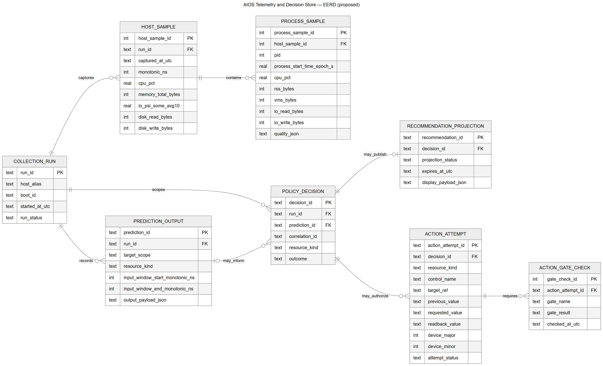
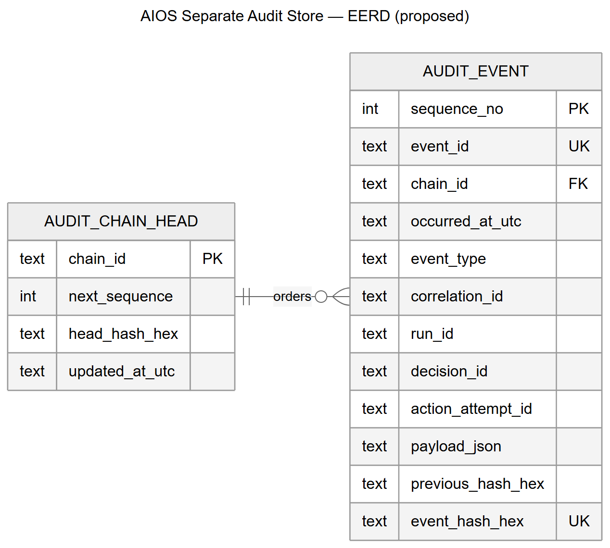

# AIOS Data Model

**Status:** proposed logical/physical design for team and security review. These files describe a candidate SQLite implementation; they are not evidence of a deployed database or an approved interface.

## Deliverables

- [`schema/aios_telemetry_decision_schema.sql`](schema/aios_telemetry_decision_schema.sql) — local SQLite schema for collection runs, host and process samples, generic prediction outputs, per-resource decisions, the dashboard recommendation projection, and guarded action attempts.
- [`schema/aios_audit_store_schema.sql`](schema/aios_audit_store_schema.sql) — separate SQLite database schema for append-only audit events and hash-chain metadata.
- [`diagrams/AIOS_Telemetry_Decision_EERD.mmd`](diagrams/AIOS_Telemetry_Decision_EERD.mmd) and its SVG/PNG/JPG renders — EERD of the telemetry/decision database and its foreign-key relationships.
- [`diagrams/AIOS_Audit_Store_EERD.mmd`](diagrams/AIOS_Audit_Store_EERD.mmd) and its SVG/PNG/JPG renders — EERD of the separate audit database.
- [`Data_Model_Design_Notes.md`](Data_Model_Design_Notes.md) — entities, field semantics, database boundary, assumptions, and approval/validation checklist.

## Relationship to existing project artifacts

The earlier [conceptual data model](../01_Diagrams/10_logical_data_model.mmd) remains a technology-independent view of domain concepts. These EERDs add candidate relational structures and keys using crow-foot cardinalities. They show keys and representative fields; the SQL is the complete column and constraint definition. These are EERDs, not UML diagrams, and do not replace that conceptual view. The [telemetry interface specification](../03_Data_Collection/AIOS_Telemetry_Interface_Spec.md) remains the authoritative draft for collection scope and privacy boundaries.

The main SQLite store supports bounded local telemetry and read-only recommendation projection. Audit is a separate logical store with no cross-database foreign keys; the telemetry and audit records correlate through opaque IDs (`correlation_id`, and where supplied `run_id`, `decision_id`, or `action_attempt_id`). The viewer is query-only. No schema grants a user a command, approval, mode-change, policy-edit, or actuation path.

## Use and change control

Treat all field names, constraints, JSON envelopes, event taxonomy, retention settings, and indexes as proposals pending agreement with the AI/model, host, and security owners. Keep unavailable or denied values null and preserve their quality reason; do not convert missing values to zero. Do not store usernames, command lines, environment variables, filesystem paths, or raw cgroup paths in target references. Choose and document retention, size/WAL caps, backup/export, migration, access control, audit-chain anchoring, and recovery before deployment.

## EERD previews

### Telemetry and decision store

[Open SVG](diagrams/AIOS_Telemetry_Decision_EERD.svg) · [Editable Mermaid source](diagrams/AIOS_Telemetry_Decision_EERD.mmd)

### Separate audit store

[Open SVG](diagrams/AIOS_Audit_Store_EERD.svg) · [Editable Mermaid source](diagrams/AIOS_Audit_Store_EERD.mmd)

